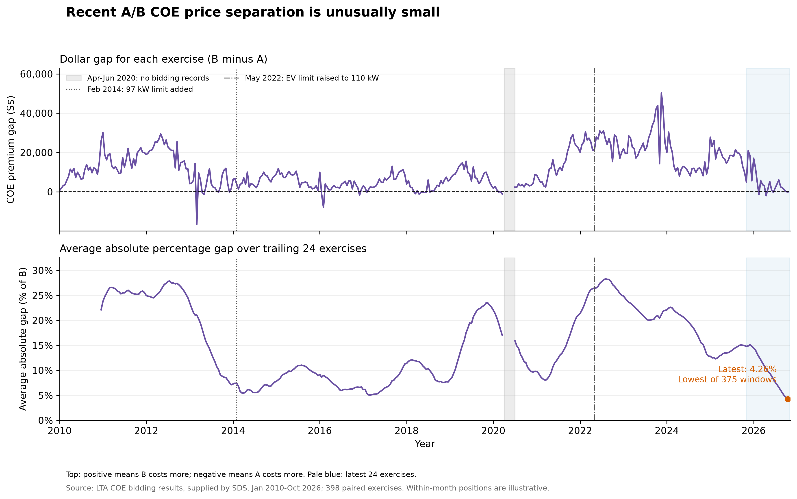
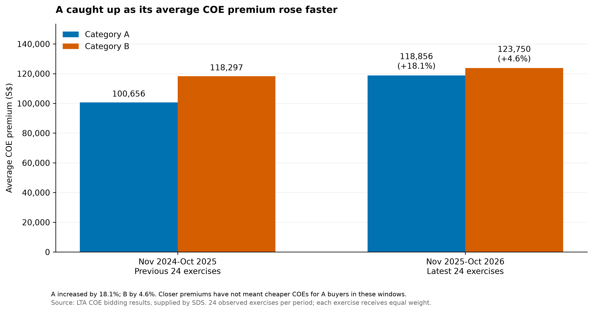
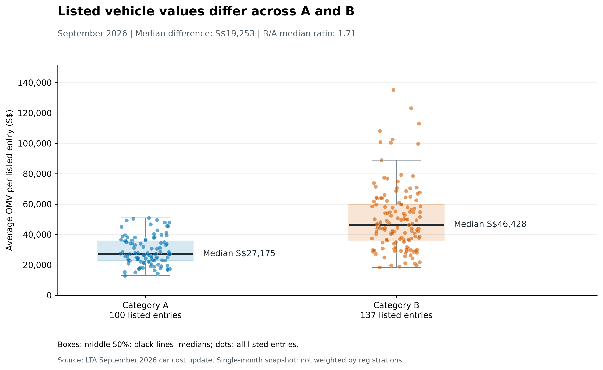

# Singapore COE Price Convergence & Category Policy

A data-analysis case study by **Team Godex** for the **SDS Mini Datathon 2026**. The project combines historical COE auction results, reported registration mix and a vehicle-value snapshot to examine the Category A/B split.

**Question:** Do unusually close A/B COE premiums justify merging the categories, and how would an OMV-based feebate change buyer costs under different price assumptions?

**Tools:** Python 3.14 · pandas · NumPy · Matplotlib · LightGBM · scikit-learn · skforecast

## Main findings

- **Recent COE separation is unusually small.** The average absolute percentage gap fell from **14.95% to 4.26%**, and the average absolute dollar gap from **S$17,641 to S$5,224**, between the preceding and latest 24 bidding exercises. The latest percentage average is the lowest among 375 overlapping 24-exercise windows in the supplied history.
- **Convergence came through A becoming more expensive.** A's average premium rose **18.1%**, versus **4.6%** for B. In the latest window, 19 of 24 exercises had an absolute gap within 5% of B's premium.
- **Listed vehicle values still differ.** Median listed OMV is **S$27,175 for A** and **S$46,428 for B** in September 2026. This is a single-month comparison of listed entries, without registration weighting.
- **Forecasts allow for renewed separation, with substantial limits.** Historical test MAE improvements over matched no-change baselines are **17.84% for A** and **6.42% for B**. Model selection used inspected historical tests; B's rounds 13–24 extend beyond its evaluated horizon.
- **Feebates redistribute costs, while savings depend on the merged premium.** A higher assumed merged price can consume the rebate. The quota-weighted merged price is a scenario proxy, not an estimated auction-clearing outcome.

The previous comparison window is **November 2024–October 2025**; the latest is **November 2025–October 2026**. Absolute percentage gap is `abs(B premium - A premium) / B premium × 100`, averaged across exercises. All results describe the fixed datasets included here; they are not current-market prices.

## Selected figures

### Recent premium separation



### How convergence happened



### Listed vehicle values



## Team recommendation

**Retain the existing A/B split for now, while reviewing Cat A's weakened COE price advantage.** Similar premiums do not establish similar vehicle values, permanent convergence or a benefit from merging.

A **five-band OMV-based feebate** is a potential longer-term reform. Adoption would depend on rebates covering the loss of Cat A's price advantage for intended beneficiaries, an acceptable distribution of costs compared with three bands, and buyer protection and sustainable rebate funding under higher merged-premium scenarios. These are adoption conditions, rather than outcomes demonstrated by the present simulations.

## Repository guide

| Path | Purpose |
| --- | --- |
| [`main.ipynb`](main.ipynb) | Start here: integrated team analysis, forecasting evaluation, policy scenarios and 13 figures |
| [`trend_analysis.ipynb`](trend_analysis.ipynb) | Austin's extended trend investigation and exploratory sensitivity checks |
| [`data/`](data/) | Three input CSV snapshots and source documentation |
| [`figures/`](figures/) | The 13 final figure exports generated by `main.ipynb` |
| [`requirements.txt`](requirements.txt) | Pinned Python package versions |
| [`scripts/run_notebooks.py`](scripts/run_notebooks.py) | Execute both notebooks in fresh kernels from this repository |

## Run locally

Use **Python 3.14**. Create an environment and install the dependencies from the repository root.

**Windows PowerShell**

```powershell
py -3.14 -m venv .venv
.\.venv\Scripts\python.exe -m pip install -r requirements.txt
```

**macOS / Linux**

```bash
python3.14 -m venv .venv
.venv/bin/python -m pip install -r requirements.txt
```

Open the notebooks in VS Code with the Jupyter extension, select this `.venv` as the Python kernel, and use **Restart Kernel → Run All**. Both notebooks use paths relative to the repository root. The forecasting evaluation can take several minutes; figure exports are written to `figures/`.

To run both notebooks without the editor, use the environment's Python:

```powershell
# Windows
.\.venv\Scripts\python.exe scripts/run_notebooks.py
```

```bash
# macOS / Linux
.venv/bin/python scripts/run_notebooks.py
```

### Validation

Both notebooks were executed independently from this folder on **4 November 2026**, using **Python 3.14.2** and the pinned packages. All code cells completed with no errors or saved warnings. The team notebook regenerated the 13 figure exports from the three included CSV files.

| Notebook | Executed code cells | Runtime on the preparation machine |
| --- | ---: | ---: |
| `main.ipynb` | 40 | 62.8 seconds |
| `trend_analysis.ipynb` | 36 | 9.7 seconds |

## Data and limitations

The analysis uses COE bidding data for **January 2010–October 2026**, car registrations for **January 2016–May 2025**, and an **OMV snapshot for September 2026**. Providers, coverage and file checksums are documented in [`data/README.md`](data/README.md).

Important limits include changing category rules, overlapping windows, unknown registration counts, a single unweighted OMV snapshot, exploratory forecast selection and hypothetical merger prices. Registration data does not identify model-level COE categories or buyer incomes. The analyses do not establish policy causality, permanent convergence, market-wide buyer savings or government revenue neutrality.

## Team contributions

| Member | Primary workstream |
| --- | --- |
| **Lew Wai Loon (Austin)** | Premium trends and historical comparisons; contributions to data preparation and notebook integration |
| **Wong E Shen** | Registration mix, EV/brand patterns and listed OMV comparisons |
| **Eugene Poon Wen Teng** | Category B forecasting |
| **Eng Cheng Xin** | Category A forecasting and merger/feebate scenarios |

OpenAI Codex assisted with implementation, data checks, exploratory analysis, visualisation, notebook integration and documentation. The notebooks state the methods, assumptions and interpretation limits alongside the results.
